# Ágora Architecture & System of Record (`ARCHITECTURE.md`)

This document serves as the authoritative System of Record for **Ágora**, defining its architecture, C4 model hierarchy, domain boundaries, persistence topology, lifecycle state machines, and end-to-end sequence flows.

---

## Section 1: System Overview & C4 Model Architecture (Levels 1–4)

### 1.1 C4 Level 1 — System Context Diagram

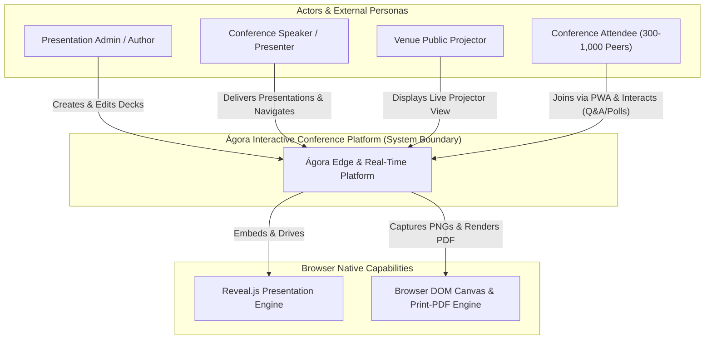

---

### 1.2 C4 Level 2 — Container Diagram

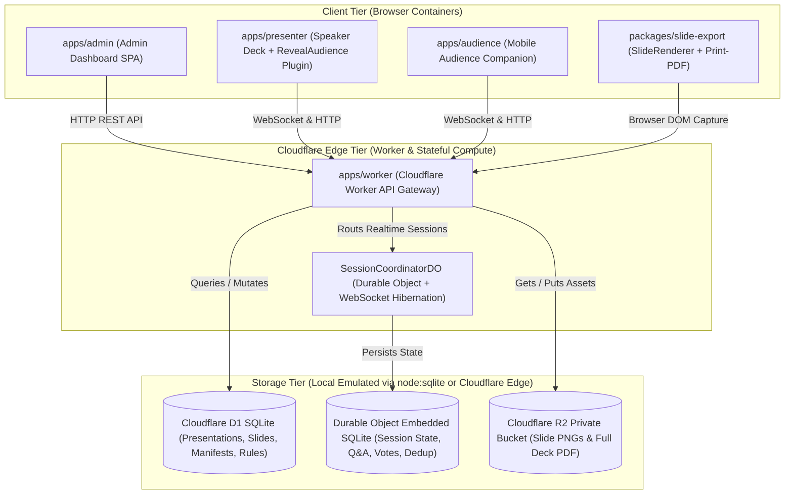

---

### 1.3 C4 Level 3 — Component Diagram

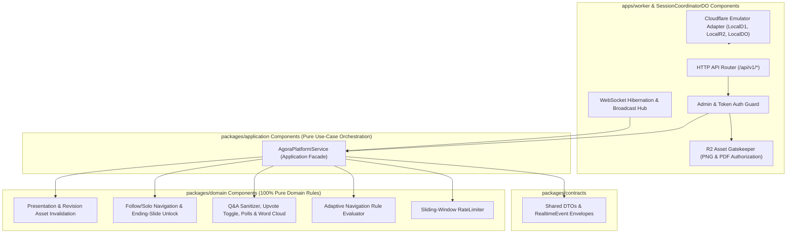

---

### 1.4 C4 Level 4 — Code & Domain Class Diagram

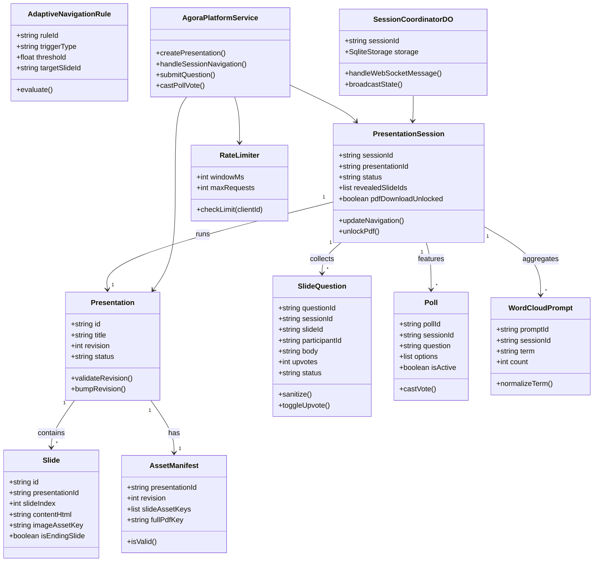

---

## Section 2: Monorepo Structure & Clean Architecture Dependency Rules

### 2.1 Monorepo Directory Layout
```
/Users/alrs/Documents/agora/
├── apps/
│   ├── admin/             # Admin Dashboard SPA
│   ├── audience/          # Mobile Audience Companion PWA
│   ├── presenter/         # Speaker Deck + RevealAudience Plugin
│   └── worker/            # Cloudflare Worker API Gateway & Durable Objects
├── packages/
│   ├── application/       # Pure use-case orchestration
│   ├── contracts/         # Shared DTOs and RealtimeEvent envelopes
│   ├── domain/            # 100% Pure domain business rules & invariants
│   ├── emulator/          # Local Cloudflare emulation (node:sqlite + local R2)
│   ├── slide-export/      # SlideRenderer & Print-PDF capture engine
│   └── ui/                # Shared design system components
├── harness/               # Architecture verifiers and victory detectors
└── docs/                  # System documentation & specifications
```

### 2.2 Mechanical Dependency Rules & Invariants
- **Strict Domain Boundary**: `packages/domain` and `packages/application` **MUST NEVER** import Cloudflare Workers, React, DOM, or Reveal.js.
- **Enforcement**: Enforced by `harness/verify-architecture.mjs`, ESLint rules (`eslint.config.mjs`), and TypeScript project references.
- **WIP = 1 Invariant**: At most one feature active in `feature_list.json` at any given time.

---

## Section 3: Persistence Topology & Entity-Relationship Diagram (`erDiagram`)

### 3.1 Storage Comparison
| Storage Layer | Technology | Purpose & Access Pattern |
| :--- | :--- | :--- |
| **Global Storage** | Cloudflare D1 SQLite | Presentations, slides, markdown sources, asset manifests, navigation rules. Read-heavy. |
| **Stateful Edge Compute** | Durable Object SQLite | Real-time session state, participant tracking, Q&A, votes, event deduplication (`ctx.storage.sql`). |
| **Asset Storage** | Cloudflare R2 Private Bucket | Static slide PNGs, full deck PDFs, authorized via signed URL gateways. |
| **Local Emulation** | `packages/emulator` (`node:sqlite`) | Local development without requiring remote Cloudflare deployment. |

### 3.2 Entity-Relationship Diagram (`erDiagram`)

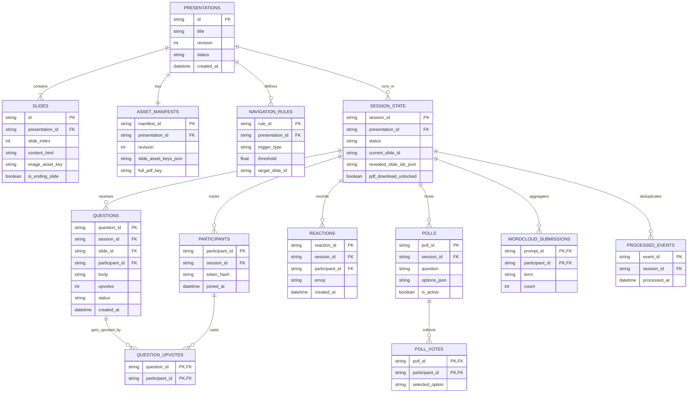

---

## Section 4: Session & Asset Lifecycle State Machine (`stateDiagram-v2`)

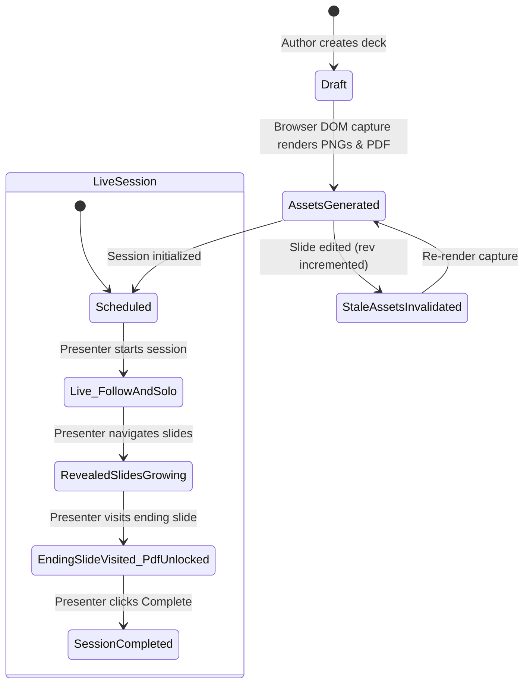

---

## Section 5: End-to-End Sequence Diagrams (`sequenceDiagram`)

### 5.1 Presentation Authoring, Browser-Side PNG Capture, Native PDF Export & Asset Invalidation (`SPEC-001`, `SPEC-013`, `SPEC-015`, `SPEC-024`)

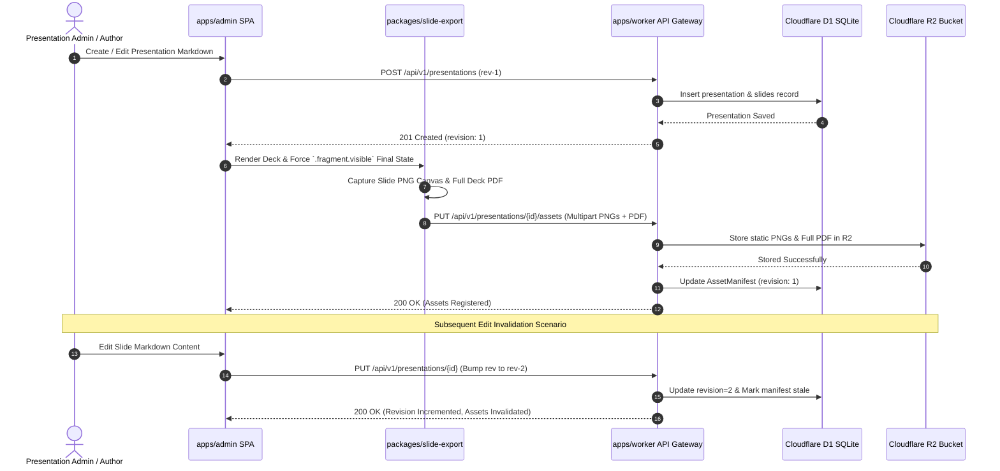

---

### 5.2 Anonymous Attendee Join, Presenter Slide Navigation & Follow vs. Solo Mode (`SPEC-002`, `SPEC-003`, `SPEC-004`, `SPEC-005`, `SPEC-023`)

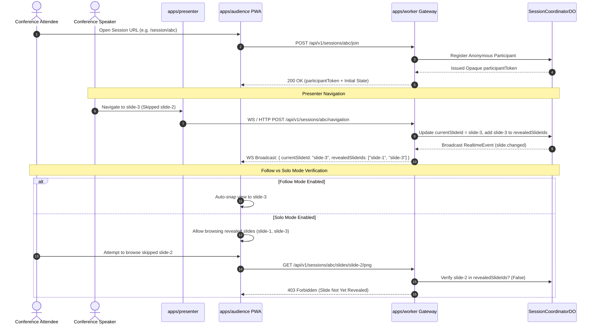

---

### 5.3 Slide-Scoped Q&A Submission, Idempotent Upvoting & Embedded Q&A Detail View Without Deck Navigation (`SPEC-006`, `SPEC-007`, `SPEC-008`, `SPEC-018`)

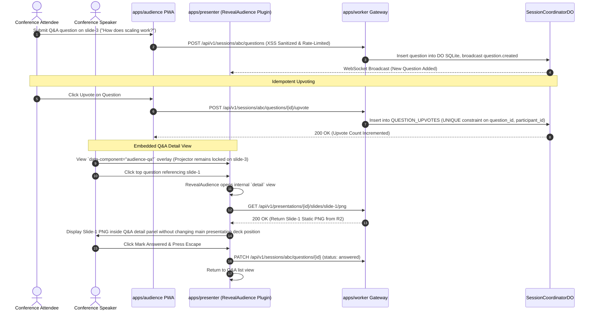

---

### 5.4 Contextual Polls, Adaptive Navigation Suggestion & Word Cloud Normalization (`SPEC-010`, `SPEC-011`, `SPEC-021`)

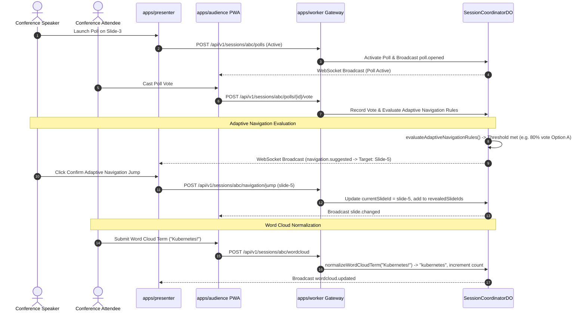

---

### 5.5 Gated Slide PNG Download, Ending-Slide Full PDF Unlock & Explicit Session Completion (`SPEC-014`, `SPEC-016`, `SPEC-022`, `SPEC-024`)

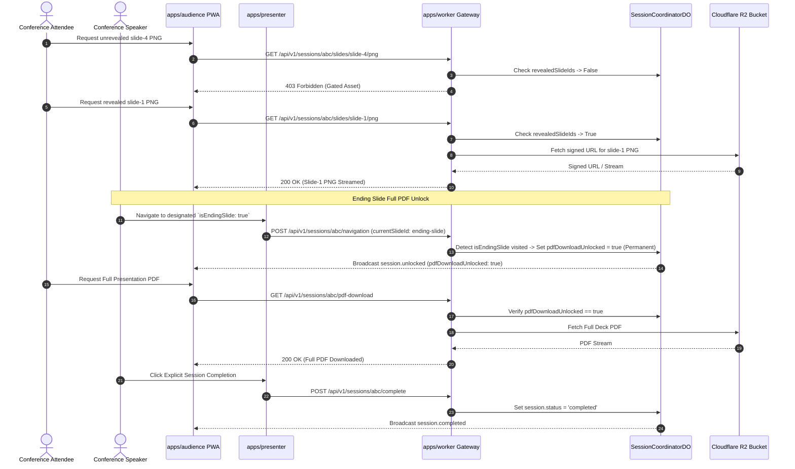

---

### 5.6 Offline Reveal.js Resilience, Exponential Backoff Reconnection & Event Deduplication (`SPEC-003`, `SPEC-019`)

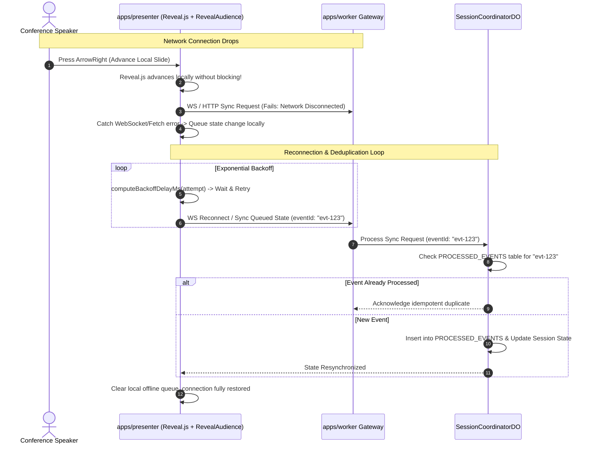

---

## Section 6: HTTP API & WebSocket RealtimeEvent Reference

### 6.1 HTTP REST API Endpoints (`/api/v1/*`)
| Endpoint | Method | Description |
| :--- | :--- | :--- |
| `/api/v1/presentations` | `POST` | Create a new presentation deck with markdown and slides. |
| `/api/v1/presentations/{id}` | `PUT` | Update presentation revision and invalidate stale assets. |
| `/api/v1/presentations/{id}/assets` | `PUT` | Upload rendered slide PNGs and full PDF to R2. |
| `/api/v1/sessions` | `POST` | Initialize a live presentation session. |
| `/api/v1/sessions/{id}/join` | `POST` | Join session anonymously, returning an opaque `participantToken`. |
| `/api/v1/sessions/{id}/navigation` | `POST` | Update current slide and revealed slide IDs. |
| `/api/v1/sessions/{id}/questions` | `POST` | Submit XSS-sanitized and rate-limited Q&A question. |
| `/api/v1/sessions/{id}/questions/{qid}/upvote` | `POST` | Idempotently toggle question upvote. |
| `/api/v1/sessions/{id}/polls` | `POST` | Create or activate a contextual poll. |
| `/api/v1/sessions/{id}/polls/{pid}/vote` | `POST` | Cast vote on an active poll. |
| `/api/v1/sessions/{id}/wordcloud` | `POST` | Submit and normalize word cloud term. |
| `/api/v1/sessions/{id}/slides/{sid}/png` | `GET` | Gated retrieval of slide PNG from R2 (`403` if unrevealed). |
| `/api/v1/sessions/{id}/pdf-download` | `GET` | Download full presentation PDF (`403` if ending slide not visited). |
| `/api/v1/sessions/{id}/complete` | `POST` | Explicitly complete and lock session. |

### 6.2 WebSocket RealtimeEvent Envelopes
| Event Type | Payload | Description |
| :--- | :--- | :--- |
| `slide.changed` | `{ currentSlideId, revealedSlideIds }` | Broadcasted when presenter changes slides. |
| `question.created` | `{ questionId, slideId, body, upvotes }` | Broadcasted when a new question is submitted. |
| `question.upvoted` | `{ questionId, upvotes }` | Broadcasted when a question upvote count changes. |
| `poll.opened` | `{ pollId, question, options }` | Broadcasted when a poll becomes active. |
| `navigation.suggested` | `{ ruleId, targetSlideId, triggerType }` | Broadcasted when adaptive navigation rules trigger. |
| `wordcloud.updated` | `{ promptId, terms }` | Broadcasted when word cloud terms are aggregated. |
| `session.unlocked` | `{ pdfDownloadUnlocked }` | Broadcasted when ending slide is reached. |
| `session.completed` | `{ status: "completed" }` | Broadcasted when session ends. |
