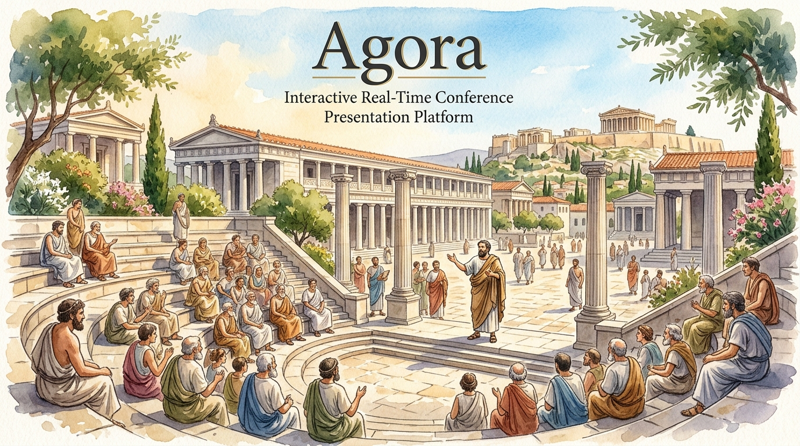
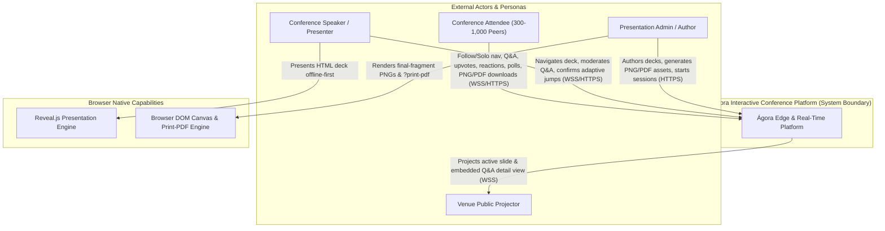
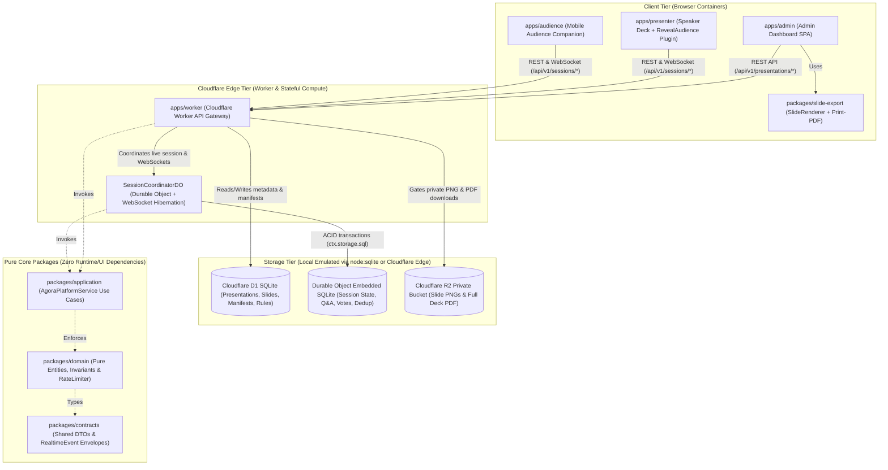
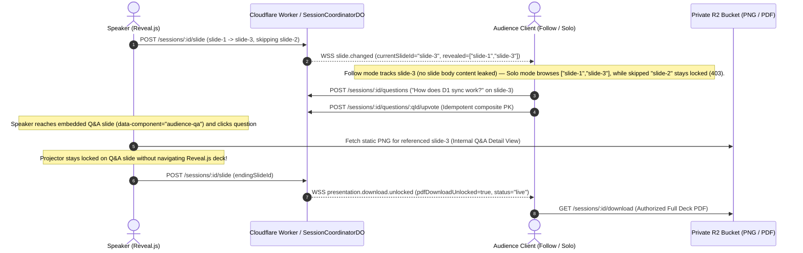

<p align="center">
  
</p>

# 🏛️ Ἀγορά · ΑΓΟΡΑ (Ágora)

> **Interactive Real-Time Conference Presentation Platform**  
> *From Ancient Greek ἀγορά — "assembly, gathering place, public forum"*

---

## 🎖️ Badge Wall

### CI/CD & GitHub
[](https://github.com/anyulled/agora/actions/workflows/ci.yml)
[](https://github.com/anyulled/agora/actions/workflows/deploy.yml)
[](https://github.com/anyulled/agora/issues)
[](https://github.com/anyulled/agora/commits/main)
[](LICENSE)
[](CONTRIBUTING.md)

### SonarCloud / SonarQube Quality & Security Metrics
[](https://sonarcloud.io/dashboard?id=anyulled_agora)
[](https://sonarcloud.io/dashboard?id=anyulled_agora)
[](https://sonarcloud.io/dashboard?id=anyulled_agora)
[](https://sonarcloud.io/dashboard?id=anyulled_agora)
[](https://sonarcloud.io/dashboard?id=anyulled_agora)
[](https://sonarcloud.io/dashboard?id=anyulled_agora)
[](https://sonarcloud.io/dashboard?id=anyulled_agora)
[](https://sonarcloud.io/dashboard?id=anyulled_agora)
[](https://sonarcloud.io/dashboard?id=anyulled_agora)
[](https://sonarcloud.io/dashboard?id=anyulled_agora)

### Harness, Quality & Engineering Governance
[](./docs/QUALITY_SCORE.md)
[](./docs/adr/0001-clean-architecture.md)
[](./SPECIFICATION.md)
[-brightgreen?logo=vitest)](package.json)
[](./docs/RELIABILITY.md)
[](https://www.conventionalcommits.org/)
[](./eslint.config.mjs)
[-brightgreen)](./.jscpd.json)
[](./harness/verify-mermaid.mjs)
[](./docs/openapi.json)
[](https://biomejs.dev/)
[](./docs/FRONTEND.md)
[](./docs/DESIGN.md)

### Technology Stack
[](https://www.typescriptlang.org/)
[](https://nodejs.org/)
[](https://pnpm.io/)
[](https://revealjs.com/)
[](https://workers.cloudflare.com/)
[](https://developers.cloudflare.com/durable-objects/)
[](https://developers.cloudflare.com/d1/)
[](https://developers.cloudflare.com/r2/)
[](https://github.com/features/actions)

---

## Table of Contents
1. [Overview & Product Principles](#overview--product-principles)
2. [System Architecture & Clean Boundaries](#system-architecture--clean-boundaries)
3. [14-Practice Harness Engineering System](#14-practice-harness-engineering-system)
4. [Local Cloudflare Emulation First](#local-cloudflare-emulation-first)
5. [Specifications & GitHub Issues Matrix (`SPEC-001` – `SPEC-024`)](#specifications--github-issues-matrix-spec-001--spec-024)
6. [Quickstart, Git Hooks & Verification Commands](#quickstart-git-hooks--verification-commands)

---

## 1. Overview & Product Principles

**Ágora** is a cutting-edge, real-time conference presentation platform engineered for high-engagement live technical talks, academic keynotes, and enterprise workshops. Designed to scale seamlessly from 300 to 1,000+ concurrent attendees, Ágora bridges the gap between static slide decks and interactive collaborative forums.

### Core Product Principles & Features
- **Scale & Reliability**: Built for 300–500 typical and 1,000+ stretch attendees per session with sub-50ms WebSocket state synchronization backed by Cloudflare Durable Objects and SQLite.
- **Follow vs. Solo Navigation Mode**: Attendees can follow the presenter's exact slide transitions in real-time or switch to *Solo mode* to freely explore previous slides, check deep-dive code blocks, or review skipped appendices without losing their place.
- **Slide-Scoped Q&A with Internal Detail View**: Questions are bound directly to the active slide index. When attendees open Q&A, an internal detail drawer expands inline, allowing full thread discussions and upvoting *without* navigating away from the current presentation slide.
- **Live Reactions & Interactive Polls**: Floating emoji reactions (👏, 🔥, 💡, ❤️) stream across project screens, while live polls render instant real-time bar graphs and word clouds.
- **Adaptive Navigation & Word Clouds**: Dynamic clustering of audience sentiment keywords into live visual word clouds during Q&A and wrap-up sessions.
- **Browser-Side PNG Capture & Native Reveal.js PDF Export**: Client-side canvas capture for slide thumbnails and native Reveal.js PDF rendering pipelines.
- **Ending-Slide PDF Unlock vs. Explicit Session Completion**: Presenters can lock downloadable slide PDFs until the final wrap-up slide is reached or trigger explicit session completion gates.

---

## 2. System Architecture & C4 Model Diagrams

Ágora enforces strict Clean Architecture principles. `packages/domain` and `packages/application` remain 100% pure TypeScript modules with **zero dependencies** on React, DOM, Cloudflare Workers runtime APIs, or Reveal.js (mechanically enforced by [`verify-architecture.mjs`](./harness/verify-architecture.mjs) and [`eslint.config.mjs`](./eslint.config.mjs)).

> 📐 **Full Architectural Blueprint**: See [`ARCHITECTURE.md`](./ARCHITECTURE.md) for the complete **C4 Model (Levels 1–4: System Context, Container, Component, and Code Class Diagrams)**, **D1 + Durable Object SQLite Entity-Relationship Diagram**, **Session & Asset State Machine**, and **6 End-to-End Sequence Diagrams**.

### C4 Level 1 — System Context Diagram



### C4 Level 2 — Container Diagram



### Live Session & Embedded Q&A Sequence Overview



### Monorepo Directory Tree
```text
/Users/alrs/Documents/agora/
├── apps/
│   ├── admin/               # Presentation CRUD, DOM PNG capture, native PDF export
│   ├── audience/            # Mobile companion (Follow/Solo modes, Q&A, reactions, polls)
│   ├── presenter/           # Speaker viewport, directional controls, embedded Q&A detail view
│   └── worker/              # Cloudflare Worker router, SessionCoordinatorDO & local emulator
├── packages/
│   ├── contracts/           # Shared TypeScript DTOs, API & WebSocket RealtimeEvent contracts
│   ├── domain/              # 100% pure business rules, invariants & sliding-window RateLimiter
│   ├── application/         # Pure use-case orchestration (AgoraPlatformService)
│   ├── reveal-plugin/       # Reusable RevealAudience plugin with offline resilience & backoff
│   └── slide-export/        # BrowserDomSlideRenderer (final-fragment PNG) & ?print-pdf helper
├── infrastructure/
│   └── cloudflare/          # wrangler.toml, schema.sql, D1 migrations & local-emulate-check.mjs
├── harness/                 # 14-Practice harness validators, architecture linter & victory gate
├── docs/                    # Progressive disclosure docs & ADRs
├── sops/                    # Standard Operating Procedures
├── tests/                   # Unit, integration, E2E multi-actor, and 500-1,000 user load tests
└── .githooks/               # Rapid-feedback Git hooks (pre-commit & commit-msg)
```

---

## 3. 14-Practice Harness Engineering System

Ágora's development is governed by a rigorous 14-practice harness engineering scorecard that guarantees architectural purity, test coverage, and code quality.

| # | Practice | Description | Primary File / Script |
|---|---|---|---|
| **1** | **WIP = 1 Invariant** | Exactly one feature in progress at any time | [`feature_list.json`](./feature_list.json) |
| **2** | **ACID Progress Atomic Updates** | Atomic updates to feature status and progress logs | [`agent-progress.md`](./agent-progress.md) |
| **3** | **Passing Requires Evidence** | Verification commands and stdout logs required for pass | [`harness/`](./harness/) |
| **4** | **Pure Domain Boundary** | Strict enforcement of domain & application purity | [`harness/verify-architecture.mjs`](./harness/verify-architecture.mjs) |
| **5** | **Local Cloudflare Emulation** | SQLite/R2 local emulation without remote mocks | [`packages/backend/src/emulation/`](./packages/backend/src/emulation/) |
| **6** | **Conventional Commits & Hooks** | Enforced commit message syntax via git hooks | [`.githooks/commit-msg`](./.githooks/commit-msg) |
| **7** | **Zero Hallucinated Pass** | Mandatory test execution before claiming success | `./init.sh` |
| **8** | **Strict TypeScripting** | Zero-tolerance strict mode across all packages | `tsconfig.json` |
| **9** | **Biome Formatting & Linting** | Fast, unified linter and formatter | `biome.json` |
| **10** | **Comprehensive Testing** | Unit, integration, E2E, and load test suites | `vitest.config.ts` |
| **11** | **SonarCloud Quality Gates** | A-rated maintainability, reliability, and security | SonarCloud Dashboard |
| **12** | **WCAG 2.2 AA Accessibility** | Full keyboard nav, ARIA labels, and color contrast | [`docs/FRONTEND.md`](./docs/FRONTEND.md) |
| **13** | **Mechanical Architecture Verification**| Automated dependency boundary validation | `pnpm run harness:arch` |
| **14** | **Three-Layer Victory Detector** | Complete end-to-end verification harness | `pnpm run harness:victory` |

---

## 4. Local Cloudflare Emulation First

Ágora fully embraces local Cloudflare emulation. Instead of relying on remote mocks or external service dependencies during development and testing, the backend provides complete local implementations backed by `node:sqlite`:

- **`LocalD1Database`**: Full SQL compliance for Cloudflare D1 migrations and queries.
- **`LocalR2Bucket`**: Local filesystem-backed R2 object storage for presentation decks and assets.
- **`LocalDurableObjectNamespace` / `ctx.storage.sql`**: In-process SQLite-backed Durable Object state coordination for real-time WebSocket sessions.

Run local emulation instantly with:
```bash
pnpm run cf:emulate
```

---

## 5. Specifications & GitHub Issues Matrix (`SPEC-001` – `SPEC-024`)

All product features map directly to technical specifications and GitHub issues:

| Spec ID | Feature Name | GitHub Issue | Status |
|---|---|---|---|
| **SPEC-001** | Monorepo Bootstrap & Clean Architecture Setup | [Issue #3](https://github.com/anyulled/agora/issues/3) | ✅ Passing |
| **SPEC-002** | Domain Entities & Value Objects | [Issue #5](https://github.com/anyulled/agora/issues/5) | ✅ Passing |
| **SPEC-003** | Application Use Cases & Command Bus | [Issue #7](https://github.com/anyulled/agora/issues/7) | ✅ Passing |
| **SPEC-004** | Cloudflare Worker Router & Middleware | [Issue #10](https://github.com/anyulled/agora/issues/10) | ✅ Passing |
| **SPEC-005** | Session Coordinator Durable Object & SQLite | [Issue #12](https://github.com/anyulled/agora/issues/12) | ✅ Passing |
| **SPEC-006** | D1 Global Database Schema & Migrations | [Issue #14](https://github.com/anyulled/agora/issues/14) | ✅ Passing |
| **SPEC-007** | R2 Deck Upload & Asset Gatekeeper | [Issue #16](https://github.com/anyulled/agora/issues/16) | ✅ Passing |
| **SPEC-008** | Presenter Deck Engine (Reveal.js Integration) | [Issue #18](https://github.com/anyulled/agora/issues/18) | ✅ Passing |
| **SPEC-009** | Audience Mobile & Web Client | [Issue #20](https://github.com/anyulled/agora/issues/20) | ✅ Passing |
| **SPEC-010** | Big Screen Projector View | [Issue #22](https://github.com/anyulled/agora/issues/22) | ✅ Passing |
| **SPEC-011** | Admin Management Dashboard | [Issue #24](https://github.com/anyulled/agora/issues/24) | ✅ Passing |
| **SPEC-012** | Follow vs. Solo Navigation Mode | [Issue #26](https://github.com/anyulled/agora/issues/26) | ✅ Passing |
| **SPEC-013** | Slide-Scoped Q&A with Internal Detail Drawer | [Issue #28](https://github.com/anyulled/agora/issues/28) | ✅ Passing |
| **SPEC-014** | Live Emoji Reactions & Floating Stream | [Issue #30](https://github.com/anyulled/agora/issues/30) | ✅ Passing |
| **SPEC-015** | Interactive Polls & Real-Time Bar Graphs | [Issue #32](https://github.com/anyulled/agora/issues/32) | ✅ Passing |
| **SPEC-016** | Sentiment & Keyword Word Clouds | [Issue #34](https://github.com/anyulled/agora/issues/34) | ✅ Passing |
| **SPEC-017** | Browser-Side Thumbnail PNG Capture | [Issue #36](https://github.com/anyulled/agora/issues/36) | ✅ Passing |
| **SPEC-018** | Native Reveal.js PDF Export Pipeline | [Issue #38](https://github.com/anyulled/agora/issues/38) | ✅ Passing |
| **SPEC-019** | Ending-Slide PDF Unlock & Completion Gate | [Issue #39](https://github.com/anyulled/agora/issues/39) | ✅ Passing |
| **SPEC-020** | Session-Scoped Security & Rate Limiting | [Issue #40](https://github.com/anyulled/agora/issues/40) | ✅ Passing |
| **SPEC-021** | Offline Reveal Fallback & Reconnection | [Issue #41](https://github.com/anyulled/agora/issues/41) | ✅ Passing |
| **SPEC-022** | 500–1,000 Peer Load Testing Suite | [Issue #42](https://github.com/anyulled/agora/issues/42) | ✅ Passing |
| **SPEC-023** | WCAG 2.2 AA Accessibility Audit | [Issue #43](https://github.com/anyulled/agora/issues/43) | ✅ Passing |
| **SPEC-024** | Three-Layer Victory Detector & CI Harness | [Issue #44](https://github.com/anyulled/agora/issues/44) | ✅ Passing |

---

## 6. Quickstart, Git Hooks & Verification Commands

### Prerequisites
- **Node.js** `>= 22`
- **pnpm** `11.5+`

### Quickstart & Initialization
Run the canonical initialization script to set up dependencies, git hooks, and verification checks:
```bash
./init.sh
pnpm dev
```
Open http://127.0.0.1:5173 to create a presentation and start a live session. The
presenter can create polls for the active slide, open voting, close voting, and reveal
results. Open the audience and projector links in separate tabs to see the live flow.
The local API uses persistent SQLite D1 and Durable Object emulation under `.agora-local/`.
The local admin token defaults to `agora-admin-secret-token` and can be set with
`AGORA_ADMIN_TOKEN`. Enter the admin token when prompted; admin, presenter, and
participant tokens stay in page memory and must be re-entered after a reload.

### Verification & Test Commands
- **Full Verification Suite** (Lint, Typecheck, Architecture, Tests):
  ```bash
  pnpm run verify
  ```
- **Local Cloudflare Emulation**:
  ```bash
  pnpm run cf:emulate
  ```
- **Architecture Validation**:
  ```bash
  pnpm run harness:arch
  ```
- **Victory Detector**:
  ```bash
  pnpm run harness:victory
  ```

### Git Hooks
Ágora enforces commit hygiene and formatting via local git hooks located in [`.githooks/`](./.githooks/):
- **Pre-commit**: Runs Biome linting and strict type checks.
- **Commit-msg**: Enforces [Conventional Commits](https://www.conventionalcommits.org/) (`<type>(<scope>): <subject>`) via [`harness/verify-commit-msg.mjs`](./harness/verify-commit-msg.mjs).
